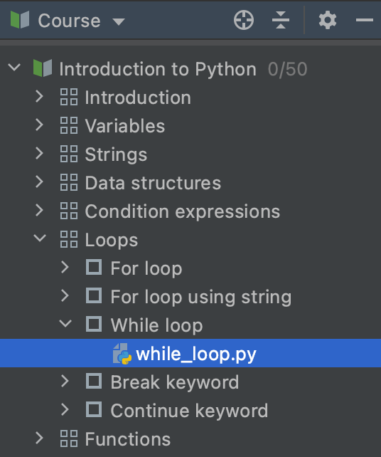

## Visualização do Curso

<b>Visualização do Curso</b> mostra o programa do curso: uma lista de lições com tarefas.

Você pode navegar para qualquer tarefa clicando duas vezes no nome da tarefa.

Para ocultar a janela de Visualização do Curso, clique no botão Janela de Ferramentas do Projeto ou pressione &shortcut:ActivateProjectToolWindow;. Isso dará mais espaço para as janelas do Editor e da Descrição da Tarefa.

Para mostrar a janela de Visualização do Curso que estava oculta, clique novamente no botão Janela de Ferramentas do Projeto (ou pressione &shortcut:ActivateProjectToolWindow;).