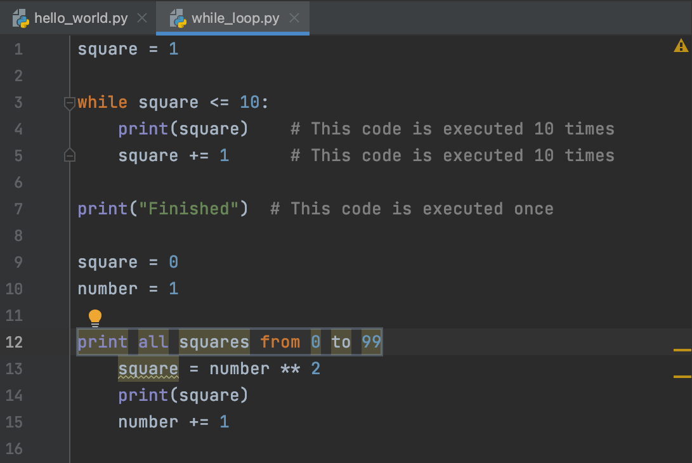
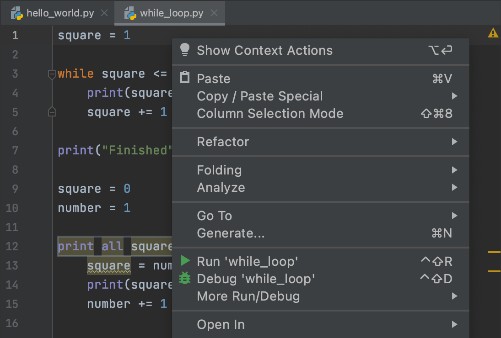

## Editor

O <b>Editor</b> é o seu playground onde você irá programar. Você pode experimentar aqui enquanto trabalha em tarefas teóricas e questionários sem ser verificado.

Para atribuições de programação, o Editor é onde você corrigirá o código existente ou escreverá seu próprio código do zero. Este código será verificado.

Para executar seu código a qualquer momento, escolha a opção Executar no menu de contexto ou pressione &shortcut:Run;:

Se você quiser voltar ao Editor e focar em seu código, a maneira mais rápida de fazer isso é com o comando Ocultar Todas as Janelas (&shortcut:HideAllWindows;). Para trazer todas as janelas de volta, repita o comando.