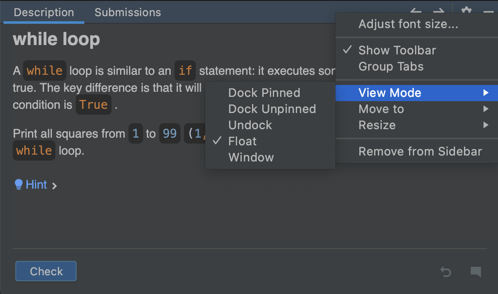

## Descrição da Tarefa

A janela de **Descrição da Tarefa** fornece todas as informações necessárias para completar uma tarefa:

Para tarefas teóricas, a descrição oferece materiais de aprendizagem e leitura.
Para questionários, apresenta perguntas de múltipla escolha.
Para atribuições de programação, enuncia o problema a ser resolvido.

Utilize os ícones de Descrição da Tarefa para as seguintes ações:

| Ícone                               | Descrição                   |
|-------------------------------------|-----------------------------|
|**Verificar**                        | Verifique a correção da sua resposta (para um questionário) ou da sua solução de código (para uma tarefa de programação)|   
| **Executar**                        | Execute seu código (para uma tarefa teórica)|
|                 | Ir para a tarefa anterior       |    
| &nbsp;ou **Próxima** | Ir para a próxima tarefa| 
|                 | Descartar todas as alterações que você fez na tarefa e começar de novo| 
|           | Visualizar a página da tarefa no Stepik e deixar um comentário| 
|<a>Pequeno vislumbre da solução...</a>             | Revelar a resposta correta e mostrar o <b>diff</b>|

Recomendamos manter a janela de Descrição da Tarefa visível e não ocultá-la completamente. Se estiver muito distrativa, você pode ocultá-la clicando no botão  no canto superior direito da janela de Descrição da Tarefa.

Se você usar dois monitores, pode ser útil mudar o painel de Descrição da Tarefa para o modo flutuante e movê-lo para o segundo monitor, ou simplesmente colocá-lo próximo à janela principal da IDE. Para fazer isso, clique no ícone de configurações da janela de ferramentas :

